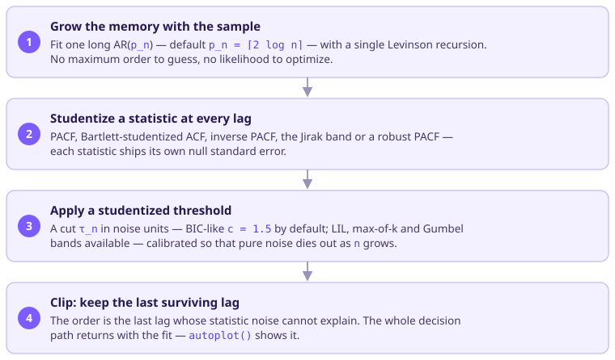
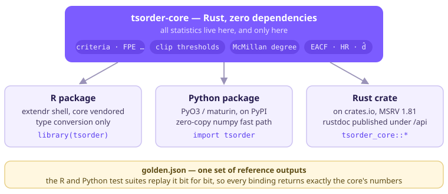

# tsorder 

[](https://doi.org/10.5281/zenodo.23607404)

How many lags does your series actually need? Before any AR, MA or ARMA
model can be fit, its **order** has to be chosen, and the answer you get
depends on the estimator you ask. `tsorder` puts the main families side by
side, computed by one dependency-free Rust core, so they can be compared on
equal footing:

* **Information criteria** — AIC, AICc, BIC, HQ, FPE, CAT and MDL over
  nested fits by Yule–Walker, Burg or conditional least squares.
* **Threshold ("clip") estimators** in the tradition of Fine & Hwang
  (1979): instead of optimizing a penalized likelihood, fit one long model,
  studentize a statistic at every lag, and keep the last lag that noise
  cannot explain. The default `order_select()` is a PACF clip — it matches
  BIC on standard AR models and beats it on subset AR in small samples.
* **McMillan-degree estimators** (the state dimension of an ARMA system):
  Bauer's SVC on past–future canonical correlations, a calibrated Hankel
  singular-value cut, and a sequential rank test — robust to observation
  noise, where AR-order methods break.
* **Supporting tools**: ARMA (p, q) identification by EACF and
  Hannan–Rissanen, the order of integration `d` by sequential unit-root
  testing, a robust (Q_n) autocorrelation, and `fit_arima()` to go from a
  selected order straight to a fitted model.

Every clip estimator follows one design rule — *every statistic comes with
its null standard error, and every threshold is applied in those studentized
units* — which is what makes the thresholds scale-invariant and comparable
across statistics. All defaults were chosen by a reproducible benchmark
shipped in the repository.

## How a clip estimator works



Swapping the studentized statistic changes what you estimate with the same
recipe: the PACF targets the AR order, the Bartlett-studentized ACF targets
the MA order, the Jirak band gives the exact Gumbel-calibrated AR rule, and
the robust PACF keeps working under outliers.

## Installation

```r
# development version, from the repository checkout (needs Rust >= 1.81):
devtools::install_github("castlaboratory/tsorder", subdir = "bindings/r")
```

A release has been submitted to CRAN; once it is accepted,
`install.packages("tsorder")` will not require a Rust toolchain on
platforms with binary packages.

## Quick start

```r
library(tsorder)
x <- arima.sim(list(ar = c(1.2, -0.6)), 400)

fit <- order_select(x)          # PACF clip, the benchmark-chosen defaults
fit$order
ggplot2::autoplot(fit)          # the whole decision path, plotted

ic_order(x, "bic")$order        # classical criteria
fh_order(x, statistic = "acf_bartlett")$order  # MA order via Bartlett band
svc_order(x)$order              # McMillan degree (robust to observation noise)
integration_order(cumsum(x))$d  # how many differences
fit_arima(x)                    # select, difference and fit in one call
```

See `vignette("tsorder")` for a guided tour and the
[estimators article](https://castlaboratory.github.io/tsorder/r/articles/estimators.html)
for the full menu.

## Architecture



All statistical logic lives in the Rust core
[`tsorder-core`](https://crates.io/crates/tsorder-core); this package is a
thin [extendr](https://extendr.rs/) shell that only converts types. The core
is vendored into the package, so installation needs no network access and no
system libraries beyond the Rust toolchain. The same core powers the
[Python package](https://pypi.org/project/tsorder/) — the three interfaces
return identical numbers, pinned by a shared golden-results file.

The R side is also cross-validated against R itself in the test suite: the
Levinson PACF matches `stats::ar.yw` to 1e-10, `qn()` matches
`robustbase::Qn` to 1e-12, and `eacf()` matches `TSA::eacf` digit for digit.

## Links

* [Package site](https://castlaboratory.github.io/tsorder/r/) ·
  [project page](https://castlaboratory.github.io/tsorder/) ·
  [Rust API docs](https://castlaboratory.github.io/tsorder/api/)
* Cite via the [Zenodo DOI](https://doi.org/10.5281/zenodo.23607404) or
  `citation("tsorder")`.
